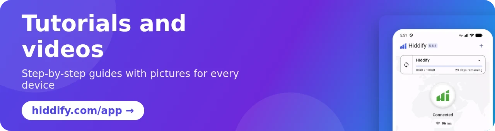

[**فارسی 🇮🇷**](README_fa.md) / [**Русский 🇷🇺**](README_ru.md) / [**简体中文 🇨🇳**](README_cn.md) / [**日本語 🇯🇵**](README_ja.md) / [**Português-BR 🇧🇷**](README_br.md)

 

 

    
  

## What is the Hiddify app?

The Hiddify app is a free, open-source and ad-free proxy and VPN client for **Android, iOS, Windows, macOS and Linux**. It is built on [sing-box](https://github.com/SagerNet/sing-box) and works with almost every protocol and subscription format, so you can use it with any proxy panel, including [Hiddify Manager](https://github.com/hiddify/Hiddify-Manager).

## 🚀 Main features

- ✈️ **One app on every device:** Android (phones and Android TV), iOS, Windows, macOS and Linux.
- 🎁 **Free profiles:** connect without a server of your own with the built-in free WARP and Psiphon profiles.
- 🟡 **Many protocols:** VLESS, VMess, Trojan, Reality, Shadowsocks, Hysteria2, TUIC, WireGuard, SSH, AnyTLS and more, with the latest [Xray-core](https://github.com/XTLS/Xray-core) and sing-box features such as [VLESS encryption](https://github.com/hiddify/hiddify-sing-box/blob/v5/docs/hiddify/features/protocols/vless-encryption.en.md).
- 🔗 **Every subscription format:** sing-box, V2Ray (Base64 or plain links), Clash and Clash Meta, with automatic subscription updates.
- 🔍 **Automatic server choice:** the app tests every server and picks the fastest one; you can also choose a server yourself.
- 🛡 **Extra security and proxy unblocker** options for countries with strong filtering, with ready rules for Iran, China, Russia and other regions.
- 🔀 **VPN or proxy mode,** per-app routing on Android, and connection sharing with other devices on your network.
- 📊 **Profile details:** remaining days and data for each subscription.
- 🌍 **30 languages,** dark and light themes.
- 💻 **[HiddifyCli](https://hiddify.com/app/HiddifyCli-guide/)** for servers and computers without a desktop.
- ⭐ **Open source, secure and community driven,** available on the official stores.

## 🛍️ Get it on the stores

&nbsp;&nbsp;&nbsp;&nbsp;&nbsp;&nbsp;&nbsp;&nbsp;

## 📥 Direct download

Files from the [latest release](https://github.com/hiddify/hiddify-app/releases/latest):

<table>
    <thead align=left>
        <tr>
            <th>OS</th>
            <th>Download</th>
        </tr>
    </thead>
    <tbody align=left>
        <tr>
            <td>Android</td>
            <td>
                 
                 
                 
                
            </td>
        </tr>
        <tr>
            <td>iOS</td>
            <td>
                 
                
            </td>
        </tr>
        <tr>
            <td>Windows</td>
            <td>
                 
                 
                
            </td>
        </tr>
        <tr>
            <td>macOS</td>
            <td>
                 
                 
                
            </td>
        </tr>
        <tr>
            <td>Linux</td>
            <td>
                 
                
            </td>
        </tr>
    </tbody>
</table>

## ⚙️ Installation and tutorials

Step-by-step guides for every device, with pictures, are on our website:

- [How to install the Hiddify app](https://hiddify.com/app/How-to-install-Hiddify-app/) (Android, iPhone, Windows, macOS, Linux)
- [How to use the Hiddify app](https://hiddify.com/app/How-to-use-Hiddify-app/) (add a profile, connect, choose a server, settings)
- [All app tutorials and videos](https://hiddify.com/app/)

## 🌎 Translations

The app is available in 30 languages. You can improve a language or add a new one by editing the JSON files in [`assets/translations`](assets/translations) or with the [Inlang online editor](https://fink.inlang.com/github.com/hiddify/hiddify-app) .

## ✏️ Acknowledgements

We sincerely thank the contributors of these projects; their solid foundation and features made this app possible:

- [sing-box](https://github.com/SagerNet/sing-box)
- [Xray](https://github.com/XTLS/Xray-core)
- [sing-box for Android](https://github.com/SagerNet/sing-box-for-android)
- [sing-box for Apple](https://github.com/SagerNet/sing-box-for-apple)
- [Clash](https://github.com/Dreamacro/clash)
- [Clash Meta](https://github.com/MetaCubeX/Clash.Meta)
- [FClash](https://github.com/Fclash/Fclash)
- [Vazirmatn font by Saber Rastikerdar](https://github.com/rastikerdar/vazirmatn)
- [Others](./pubspec.yaml)

## 🎯 Donation and support

The easiest way to support us is to give this repository a star (⭐) at the top of this page.

<a href="https://next.ossinsight.io/widgets/official/analyze-repo-stars-history?repo_id=643504282" target="_blank" style="display: block" align="center">
  <picture>
    <source media="(prefers-color-scheme: dark)" srcset="https://next.ossinsight.io/widgets/official/analyze-repo-stars-history/thumbnail.png?repo_id=643504282&image_size=auto&color_scheme=dark" width="721" height="auto">
    
  </picture>
</a>

We also need financial support for our services. All our work is voluntary, and every donation goes to the development of the project. See our [donation page](https://hiddify.com/donation-and-support/).

## 👩‍🏫 Collaboration and contact

Hiddify is a community-driven project. If you'd like to contribute, please read the [contribution guidelines](./CONTRIBUTING.md). We especially welcome help with **Flutter, Go, iOS development (Swift) and Android development (Kotlin)**.

 

We thank everyone who takes part in this project, here on GitHub and the many more outside it. It means a lot to us. ♥

Made with <a target="_blank" href="https://contrib.rocks">Contrib.Rocks</a>

