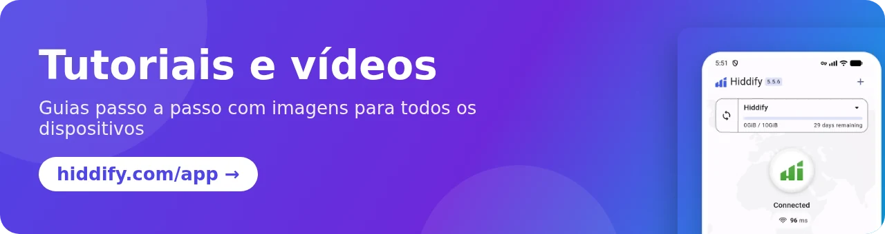

[**English 🇬🇧**](README.md) / [**فارسی 🇮🇷**](README_fa.md) / [**Русский 🇷🇺**](README_ru.md) / [**简体中文 🇨🇳**](README_cn.md) / [**日本語 🇯🇵**](README_ja.md)

 

 

    
  

## O que é o app Hiddify?

O app Hiddify é um cliente de proxy e VPN gratuito, de código aberto e sem anúncios para **Android, iOS, Windows, macOS e Linux**. Ele é baseado no [sing-box](https://github.com/SagerNet/sing-box) e funciona com quase todos os protocolos e formatos de assinatura, então você pode usá-lo com qualquer painel de proxy, incluindo o [Hiddify Manager](https://github.com/hiddify/Hiddify-Manager).

## 🚀 Principais recursos

- ✈️ **Um app em todos os dispositivos:** Android (celulares e Android TV), iOS, Windows, macOS e Linux.
- 🎁 **Perfis gratuitos:** conecte-se sem ter um servidor próprio usando os perfis gratuitos de WARP e Psiphon que já vêm no app.
- 🟡 **Muitos protocolos:** VLESS, VMess, Trojan, Reality, Shadowsocks, Hysteria2, TUIC, WireGuard, SSH, AnyTLS e outros, com os recursos mais recentes do [Xray-core](https://github.com/XTLS/Xray-core) e do sing-box, como a [criptografia VLESS](https://github.com/hiddify/hiddify-sing-box/blob/v5/docs/hiddify/features/protocols/vless-encryption.en.md).
- 🔗 **Todos os formatos de assinatura:** sing-box, V2Ray (Base64 ou links simples), Clash e Clash Meta, com atualização automática das assinaturas.
- 🔍 **Escolha automática de servidor:** o app testa todos os servidores e escolhe o mais rápido; você também pode escolher um servidor manualmente.
- 🛡 Opções de **segurança extra e desbloqueador de proxy** para países com censura forte, com regras prontas para Irã, China, Rússia e outras regiões.
- 🔀 **Modo VPN ou proxy,** roteamento por app no Android e compartilhamento da conexão com outros dispositivos da sua rede.
- 📊 **Detalhes do perfil:** dias e dados restantes de cada assinatura.
- 🌍 **30 idiomas,** temas escuro e claro.
- 💻 **[HiddifyCli](https://hiddify.com/app/HiddifyCli-guide/)** para servidores e computadores sem interface gráfica.
- ⭐ **Código aberto, seguro e mantido pela comunidade,** disponível nas lojas oficiais.

## 🛍️ Baixe nas lojas

&nbsp;&nbsp;&nbsp;&nbsp;&nbsp;&nbsp;&nbsp;&nbsp;

## 📥 Download direto

Arquivos da [versão mais recente](https://github.com/hiddify/hiddify-app/releases/latest):

<table>
    <thead align=left>
        <tr>
            <th>Sistema</th>
            <th>Download</th>
        </tr>
    </thead>
    <tbody align=left>
        <tr>
            <td>Android</td>
            <td>
                 
                 
                 
                
            </td>
        </tr>
        <tr>
            <td>iOS</td>
            <td>
                 
                
            </td>
        </tr>
        <tr>
            <td>Windows</td>
            <td>
                 
                 
                
            </td>
        </tr>
        <tr>
            <td>macOS</td>
            <td>
                 
                 
                
            </td>
        </tr>
        <tr>
            <td>Linux</td>
            <td>
                 
                
            </td>
        </tr>
    </tbody>
</table>

## ⚙️ Instalação e tutoriais

Guias passo a passo, com imagens, para todos os dispositivos estão no nosso site:

- [Como instalar o app Hiddify](https://hiddify.com/app/How-to-install-Hiddify-app/) (Android, iPhone, Windows, macOS, Linux)
- [Como usar o app Hiddify](https://hiddify.com/app/How-to-use-Hiddify-app/) (adicionar um perfil, conectar, escolher um servidor, configurações)
- [Todos os tutoriais e vídeos do app](https://hiddify.com/app/)

## 🌎 Traduções

O app está disponível em 30 idiomas. Você pode melhorar um idioma ou adicionar um novo editando os arquivos JSON em [`assets/translations`](assets/translations) ou pelo [editor online Inlang](https://fink.inlang.com/github.com/hiddify/hiddify-app) .

## ✏️ Agradecimentos

Agradecemos sinceramente aos contribuidores destes projetos; a base sólida e os recursos que eles criaram tornaram este app possível:

- [sing-box](https://github.com/SagerNet/sing-box)
- [Xray](https://github.com/XTLS/Xray-core)
- [sing-box para Android](https://github.com/SagerNet/sing-box-for-android)
- [sing-box para Apple](https://github.com/SagerNet/sing-box-for-apple)
- [Clash](https://github.com/Dreamacro/clash)
- [Clash Meta](https://github.com/MetaCubeX/Clash.Meta)
- [FClash](https://github.com/Fclash/Fclash)
- [Fonte Vazirmatn de Saber Rastikerdar](https://github.com/rastikerdar/vazirmatn)
- [Outros](./pubspec.yaml)

## 🎯 Doações e apoio

A maneira mais fácil de nos apoiar é dar uma estrela (⭐) a este repositório, no topo desta página.

<a href="https://next.ossinsight.io/widgets/official/analyze-repo-stars-history?repo_id=643504282" target="_blank" style="display: block" align="center">
  <picture>
    <source media="(prefers-color-scheme: dark)" srcset="https://next.ossinsight.io/widgets/official/analyze-repo-stars-history/thumbnail.png?repo_id=643504282&image_size=auto&color_scheme=dark" width="721" height="auto">
    
  </picture>
</a>

Também precisamos de apoio financeiro para os nossos serviços. Todo o nosso trabalho é voluntário, e cada doação vai para o desenvolvimento do projeto. Veja a nossa [página de doações](https://hiddify.com/donation-and-support/).

## 👩‍🏫 Colaboração e contato

O Hiddify é um projeto mantido pela comunidade. Se quiser contribuir, leia as [diretrizes de contribuição](./CONTRIBUTING.md). Ajuda com **Flutter, Go, desenvolvimento para iOS (Swift) e para Android (Kotlin)** é especialmente bem-vinda.

 

Agradecemos a todos que participam deste projeto, aqui no GitHub e aos muitos outros fora dele. Isso significa muito para nós. ♥

Feito com <a target="_blank" href="https://contrib.rocks">Contrib.Rocks</a>

