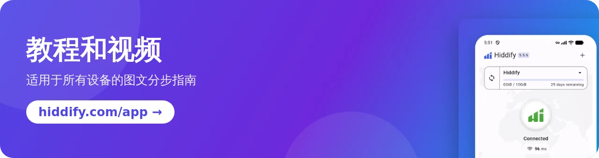

[**English 🇬🇧**](README.md) / [**فارسی 🇮🇷**](README_fa.md) / [**Русский 🇷🇺**](README_ru.md) / [**日本語 🇯🇵**](README_ja.md) / [**Português-BR 🇧🇷**](README_br.md)

 

 

    
  

## 什么是 Hiddify 应用？

Hiddify 应用是一款免费、开源、无广告的代理和 VPN 客户端，支持 **Android、iOS、Windows、macOS 和 Linux**。它基于 [sing-box](https://github.com/SagerNet/sing-box) 构建，几乎支持所有协议和订阅格式，因此可以搭配任何代理面板使用，包括 [Hiddify Manager](https://github.com/hiddify/Hiddify-Manager)。

## 🚀 主要特性

- ✈️ **一个应用，覆盖所有设备**：Android（手机和 Android TV）、iOS、Windows、macOS 和 Linux。
- 🎁 **免费配置文件**：无需自己的服务器，使用内置的免费 WARP 和 Psiphon 配置文件即可连接。
- 🟡 **多种协议**：VLESS、VMess、Trojan、Reality、Shadowsocks、Hysteria2、TUIC、WireGuard、SSH、AnyTLS 等，并支持 [Xray-core](https://github.com/XTLS/Xray-core) 和 sing-box 的最新功能，例如 [VLESS 加密](https://github.com/hiddify/hiddify-sing-box/blob/v5/docs/hiddify/features/protocols/vless-encryption.en.md)。
- 🔗 **支持所有订阅格式**：sing-box、V2Ray（Base64 或明文链接）、Clash 和 Clash Meta，并可自动更新订阅。
- 🔍 **自动选择服务器**：应用会测试所有服务器并选出最快的一个；您也可以手动选择服务器。
- 🛡 **额外安全和代理解锁器**选项，适用于网络审查严格的国家，并为伊朗、中国、俄罗斯等地区提供了现成的规则。
- 🔀 **VPN 或代理模式**，Android 分应用代理，并可与局域网内的其他设备共享连接。
- 📊 **配置文件详情**：显示每个订阅的剩余天数和剩余流量。
- 🌍 **30 种语言**，深色和浅色主题。
- 💻 **[HiddifyCli](https://hiddify.com/app/HiddifyCli-guide/)**：适用于服务器和没有桌面环境的电脑。
- ⭐ **开源、安全、社区驱动**，已在官方应用商店上架。

## 🛍️ 从应用商店下载

&nbsp;&nbsp;&nbsp;&nbsp;&nbsp;&nbsp;&nbsp;&nbsp;

## 📥 直接下载

[最新版本](https://github.com/hiddify/hiddify-app/releases/latest)的安装文件：

<table>
    <thead align=left>
        <tr>
            <th>操作系统</th>
            <th>下载</th>
        </tr>
    </thead>
    <tbody align=left>
        <tr>
            <td>Android</td>
            <td>
                 
                 
                 
                
            </td>
        </tr>
        <tr>
            <td>iOS</td>
            <td>
                 
                
            </td>
        </tr>
        <tr>
            <td>Windows</td>
            <td>
                 
                 
                
            </td>
        </tr>
        <tr>
            <td>macOS</td>
            <td>
                 
                 
                
            </td>
        </tr>
        <tr>
            <td>Linux</td>
            <td>
                 
                
            </td>
        </tr>
    </tbody>
</table>

## ⚙️ 安装和教程

我们的网站上有适用于各类设备的图文分步教程：

- [如何安装 Hiddify 应用](https://hiddify.com/app/How-to-install-Hiddify-app/)（Android、iPhone、Windows、macOS、Linux）
- [如何使用 Hiddify 应用](https://hiddify.com/app/How-to-use-Hiddify-app/)（添加配置文件、连接、选择服务器、设置）
- [全部应用教程和视频](https://hiddify.com/app/)

## 🌎 翻译

应用支持 30 种语言。您可以编辑 [`assets/translations`](assets/translations) 中的 JSON 文件，或使用 [Inlang 在线编辑器](https://fink.inlang.com/github.com/hiddify/hiddify-app) ，来改进现有语言或添加新语言。

## ✏️ 致谢

我们衷心感谢以下项目的贡献者，正是他们打下的坚实基础和开发的功能，才让这个应用成为可能：

- [sing-box](https://github.com/SagerNet/sing-box)
- [Xray](https://github.com/XTLS/Xray-core)
- [sing-box for Android](https://github.com/SagerNet/sing-box-for-android)
- [sing-box for Apple](https://github.com/SagerNet/sing-box-for-apple)
- [Clash](https://github.com/Dreamacro/clash)
- [Clash Meta](https://github.com/MetaCubeX/Clash.Meta)
- [FClash](https://github.com/Fclash/Fclash)
- [Saber Rastikerdar 设计的 Vazirmatn 字体](https://github.com/rastikerdar/vazirmatn)
- [其他](./pubspec.yaml)

## 🎯 捐赠和支持

支持我们最简单的方式，就是在本页顶部为这个仓库点一个 Star（⭐）。

<a href="https://next.ossinsight.io/widgets/official/analyze-repo-stars-history?repo_id=643504282" target="_blank" style="display: block" align="center">
  <picture>
    <source media="(prefers-color-scheme: dark)" srcset="https://next.ossinsight.io/widgets/official/analyze-repo-stars-history/thumbnail.png?repo_id=643504282&image_size=auto&color_scheme=dark" width="721" height="auto">
    
  </picture>
</a>

我们的服务也需要资金支持。我们的所有工作都是志愿性质的，每一笔捐款都会用于项目的开发。详情请见我们的[捐赠页面](https://hiddify.com/donation-and-support/)。

## 👩‍🏫 合作与联系

Hiddify 是一个社区驱动的项目。如果您想参与贡献，请阅读[贡献指南](./CONTRIBUTING.md)。我们特别欢迎以下方面的帮助：**Flutter、Go、iOS 开发（Swift）和 Android 开发（Kotlin）**。

 

感谢每一位参与这个项目的朋友，无论是在 GitHub 上，还是在 GitHub 之外。这对我们意义重大。♥

使用 <a target="_blank" href="https://contrib.rocks">Contrib.Rocks</a> 制作

