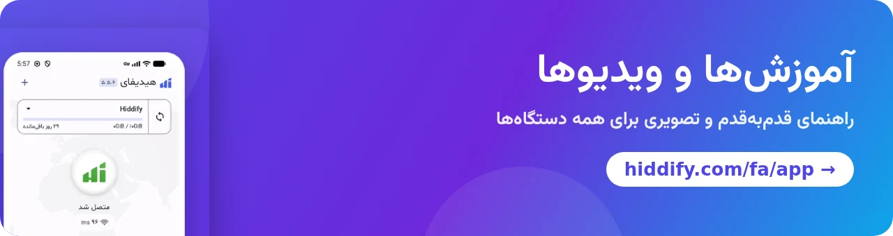

[**English 🇬🇧**](README.md) / [**Русский 🇷🇺**](README_ru.md) / [**简体中文 🇨🇳**](README_cn.md) / [**日本語 🇯🇵**](README_ja.md) / [**Português-BR 🇧🇷**](README_br.md)

 

 

    
  

## اپ هیدیفای چیست؟

اپ هیدیفای یک برنامه رایگان، متن‌باز و بدون تبلیغ برای اتصال به پروکسی و VPN است که روی **اندروید، iOS، ویندوز، مک و لینوکس** کار می‌کند. این برنامه بر پایه [sing-box](https://github.com/SagerNet/sing-box) ساخته شده و تقریبا همه پروتکل‌ها و فرمت‌های لینک اشتراک را پشتیبانی می‌کند؛ پس با هر پنلی، از جمله [هیدیفای‌منیجر](https://github.com/hiddify/Hiddify-Manager)، کار می‌کند.

## 🚀 امکانات اصلی

- ✈️ **یک برنامه برای همه دستگاه‌ها:** اندروید (گوشی و تلویزیون اندرویدی)، iOS، ویندوز، مک و لینوکس.
- 🎁 **پروفایل‌های رایگان:** بدون داشتن سرور، با پروفایل‌های رایگان WARP و Psiphon داخل برنامه وصل شوید.
- 🟡 **پروتکل‌های زیاد:** VLESS، VMess، Trojan، ریالتی (Reality)، Shadowsocks، Hysteria2، TUIC، WireGuard، SSH، AnyTLS و بیشتر، همراه با جدیدترین امکانات [Xray-core](https://github.com/XTLS/Xray-core) و sing-box مثل [VLESS encryption](https://github.com/hiddify/hiddify-sing-box/blob/v5/docs/hiddify/features/protocols/vless-encryption.en.md).
- 🔗 **همه فرمت‌های لینک اشتراک:** sing-box، V2Ray (Base64 یا لینک ساده)، Clash و Clash Meta، با به‌روزرسانی خودکار اشتراک.
- 🔍 **انتخاب خودکار سرور:** برنامه همه سرورها را تست می‌کند و سریع‌ترین را انتخاب می‌کند؛ می‌توانید سرور را خودتان هم انتخاب کنید.
- 🛡 **امنیت بیشتر و رفع مسدودیت پروکسی** برای کشورهایی با فیلترینگ شدید، با قوانین آماده برای ایران، چین، روسیه و مناطق دیگر.
- 🔀 **حالت VPN یا پروکسی،** مسیریابی جدا برای هر برنامه در اندروید، و اشتراک‌گذاری اتصال با دستگاه‌های دیگر شبکه.
- 📊 **اطلاعات پروفایل:** روزها و حجم باقی‌مانده هر اشتراک.
- 🌍 **۳۰ زبان،** پوسته روشن و تیره.
- 💻 **[HiddifyCli](https://hiddify.com/fa/app/HiddifyCli-guide/)** برای سرورها و کامپیوترهای بدون محیط گرافیکی.
- ⭐ **متن‌باز، امن و مردمی،** و در دسترس در فروشگاه‌های رسمی.

## 🛍️ دریافت از فروشگاه‌ها

&nbsp;&nbsp;&nbsp;&nbsp;&nbsp;&nbsp;&nbsp;&nbsp;

## 📥 دانلود مستقیم

فایل‌های [آخرین نسخه](https://github.com/hiddify/hiddify-app/releases/latest):

<table>
    <thead align=left>
        <tr>
            <th>OS</th>
            <th>Download</th>
        </tr>
    </thead>
    <tbody align=left>
        <tr>
            <td>Android</td>
            <td>
                 
                 
                 
                
            </td>
        </tr>
        <tr>
            <td>iOS</td>
            <td>
                 
                
            </td>
        </tr>
        <tr>
            <td>Windows</td>
            <td>
                 
                 
                
            </td>
        </tr>
        <tr>
            <td>macOS</td>
            <td>
                 
                 
                
            </td>
        </tr>
        <tr>
            <td>Linux</td>
            <td>
                 
                
            </td>
        </tr>
    </tbody>
</table>

## ⚙️ نصب و آموزش‌ها

آموزش قدم‌به‌قدم و تصویری برای همه دستگاه‌ها در سایت ما است:

- [آموزش نصب اپ هیدیفای](https://hiddify.com/fa/app/How-to-install-Hiddify-app/) (اندروید، آیفون، ویندوز، مک، لینوکس)
- [آموزش استفاده از اپ هیدیفای](https://hiddify.com/fa/app/How-to-use-Hiddify-app/) (افزودن پروفایل، اتصال، انتخاب سرور، تنظیمات)
- [همه آموزش‌ها و ویدیوهای اپ](https://hiddify.com/fa/app/)

## 🌎 ترجمه‌ها

برنامه به ۳۰ زبان در دسترس است. می‌توانید ترجمه یک زبان را بهتر کنید یا زبان جدیدی اضافه کنید: فایل‌های JSON پوشه [`assets/translations`](assets/translations) را ویرایش کنید یا از [ویرایشگر آنلاین Inlang](https://fink.inlang.com/github.com/hiddify/hiddify-app) استفاده کنید.

## ✏️ قدردانی

از مشارکت‌کنندگان این پروژه‌ها صمیمانه سپاسگزاریم؛ پایه محکم و امکانات آن‌ها این برنامه را ممکن کرده است:

- [sing-box](https://github.com/SagerNet/sing-box)
- [Xray](https://github.com/XTLS/Xray-core)
- [sing-box for Android](https://github.com/SagerNet/sing-box-for-android)
- [sing-box for Apple](https://github.com/SagerNet/sing-box-for-apple)
- [Clash](https://github.com/Dreamacro/clash)
- [Clash Meta](https://github.com/MetaCubeX/Clash.Meta)
- [FClash](https://github.com/Fclash/Fclash)
- [فونت وزیرمتن از صابر راستی‌کردار](https://github.com/rastikerdar/vazirmatn)
- [سایر موارد](./pubspec.yaml)

## 🎯 حمایت مالی و پشتیبانی

ساده‌ترین راه حمایت از ما، دادن ستاره (⭐) به این مخزن از بالای همین صفحه است.

<a href="https://next.ossinsight.io/widgets/official/analyze-repo-stars-history?repo_id=643504282" target="_blank" style="display: block" align="center">
  <picture>
    <source media="(prefers-color-scheme: dark)" srcset="https://next.ossinsight.io/widgets/official/analyze-repo-stars-history/thumbnail.png?repo_id=643504282&image_size=auto&color_scheme=dark" width="721" height="auto">
    
  </picture>
</a>

ما برای سرویس‌هایمان به حمایت مالی هم نیاز داریم. همه کارهای ما داوطلبانه است و هر کمک مالی صرف توسعه پروژه می‌شود. [صفحه حمایت مالی](https://hiddify.com/fa/donation-and-support/) را ببینید.

## 👩‍🏫 همکاری و راه‌های ارتباطی

هیدیفای یک پروژه مردمی است. اگر می‌خواهید همکاری کنید، [راهنمای مشارکت](./CONTRIBUTING.md) را بخوانید. به‌ویژه از کمک در این زمینه‌ها استقبال می‌کنیم: **Flutter، Go، توسعه iOS (Swift) و توسعه اندروید (Kotlin)**.

 

از همه کسانی که در این پروژه مشارکت دارند، چه اینجا در گیت‌هاب و چه خیلی‌های دیگر بیرون از آن، سپاسگزاریم. این برای ما خیلی ارزشمند است. ♥

Made with <a target="_blank" href="https://contrib.rocks">Contrib.Rocks</a>

