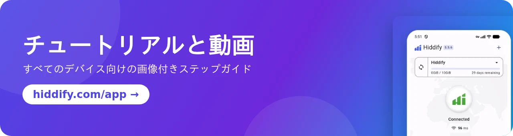

[**English 🇬🇧**](README.md) / [**فارسی 🇮🇷**](README_fa.md) / [**Русский 🇷🇺**](README_ru.md) / [**简体中文 🇨🇳**](README_cn.md) / [**Português-BR 🇧🇷**](README_br.md)

 

 

    
  

## Hiddify アプリとは？

Hiddify アプリは、**Android、iOS、Windows、macOS、Linux** に対応した、無料でオープンソース、広告なしのプロキシ / VPN クライアントです。[sing-box](https://github.com/SagerNet/sing-box) をベースにしており、ほぼすべてのプロトコルとサブスクリプション形式に対応しているため、[Hiddify Manager](https://github.com/hiddify/Hiddify-Manager) をはじめ、どのプロキシパネルとも組み合わせて使えます。

## 🚀 主な機能

- ✈️ **ひとつのアプリですべてのデバイスに対応**：Android（スマートフォンと Android TV）、iOS、Windows、macOS、Linux。
- 🎁 **無料プロファイル**：内蔵の無料 WARP・Psiphon プロファイルを使えば、自分のサーバーがなくても接続できます。
- 🟡 **豊富なプロトコル**：VLESS、VMess、Trojan、Reality、Shadowsocks、Hysteria2、TUIC、WireGuard、SSH、AnyTLS など。[VLESS 暗号化](https://github.com/hiddify/hiddify-sing-box/blob/v5/docs/hiddify/features/protocols/vless-encryption.en.md)をはじめ、最新の [Xray-core](https://github.com/XTLS/Xray-core) と sing-box の機能にも対応しています。
- 🔗 **あらゆるサブスクリプション形式**：sing-box、V2Ray（Base64 または通常のリンク）、Clash、Clash Meta に対応し、サブスクリプションは自動で更新されます。
- 🔍 **サーバーの自動選択**：すべてのサーバーをテストして最も速いものを選びます。自分で選ぶこともできます。
- 🛡 **追加セキュリティとプロキシのブロック解除**：ネット規制の厳しい国向けのオプションで、イラン、中国、ロシアなどの地域向けのルールがあらかじめ用意されています。
- 🔀 **VPN モードまたはプロキシモード**、Android でのアプリごとのルーティング、同じネットワーク内の他のデバイスとの接続共有。
- 📊 **プロファイルの詳細**：サブスクリプションごとの残り日数と残りデータ量を表示します。
- 🌍 **30 言語に対応**、ダークテーマとライトテーマ。
- 💻 **[HiddifyCli](https://hiddify.com/app/HiddifyCli-guide/)**：デスクトップ環境のないサーバーやコンピューター向け。
- ⭐ **オープンソース、安全、コミュニティ主導**。公式ストアで入手できます。

## 🛍️ ストアで入手

&nbsp;&nbsp;&nbsp;&nbsp;&nbsp;&nbsp;&nbsp;&nbsp;

## 📥 直接ダウンロード

[最新リリース](https://github.com/hiddify/hiddify-app/releases/latest)のファイル：

<table>
    <thead align=left>
        <tr>
            <th>OS</th>
            <th>ダウンロード</th>
        </tr>
    </thead>
    <tbody align=left>
        <tr>
            <td>Android</td>
            <td>
                 
                 
                 
                
            </td>
        </tr>
        <tr>
            <td>iOS</td>
            <td>
                 
                
            </td>
        </tr>
        <tr>
            <td>Windows</td>
            <td>
                 
                 
                
            </td>
        </tr>
        <tr>
            <td>macOS</td>
            <td>
                 
                 
                
            </td>
        </tr>
        <tr>
            <td>Linux</td>
            <td>
                 
                
            </td>
        </tr>
    </tbody>
</table>

## ⚙️ インストールとチュートリアル

デバイスごとの手順を画像付きで解説したガイドを、公式サイトで公開しています：

- [Hiddify アプリのインストール方法](https://hiddify.com/app/How-to-install-Hiddify-app/)（Android、iPhone、Windows、macOS、Linux）
- [Hiddify アプリの使い方](https://hiddify.com/app/How-to-use-Hiddify-app/)（プロファイルの追加、接続、サーバーの選択、設定）
- [アプリのチュートリアルと動画の一覧](https://hiddify.com/app/)

## 🌎 翻訳

アプリは 30 言語に対応しています。[`assets/translations`](assets/translations) にある JSON ファイルを編集するか、[Inlang オンラインエディター](https://fink.inlang.com/github.com/hiddify/hiddify-app)  を使って、既存の言語を改善したり、新しい言語を追加したりできます。

## ✏️ 謝辞

以下のプロジェクトのコントリビューターの皆さんに心から感謝します。その堅実な基盤と機能があったからこそ、このアプリが実現しました：

- [sing-box](https://github.com/SagerNet/sing-box)
- [Xray](https://github.com/XTLS/Xray-core)
- [sing-box for Android](https://github.com/SagerNet/sing-box-for-android)
- [sing-box for Apple](https://github.com/SagerNet/sing-box-for-apple)
- [Clash](https://github.com/Dreamacro/clash)
- [Clash Meta](https://github.com/MetaCubeX/Clash.Meta)
- [FClash](https://github.com/Fclash/Fclash)
- [Saber Rastikerdar による Vazirmatn フォント](https://github.com/rastikerdar/vazirmatn)
- [その他](./pubspec.yaml)

## 🎯 寄付とサポート

いちばん簡単な応援の方法は、このページ上部の Star（⭐）をクリックして、このリポジトリにスターを付けることです。

<a href="https://next.ossinsight.io/widgets/official/analyze-repo-stars-history?repo_id=643504282" target="_blank" style="display: block" align="center">
  <picture>
    <source media="(prefers-color-scheme: dark)" srcset="https://next.ossinsight.io/widgets/official/analyze-repo-stars-history/thumbnail.png?repo_id=643504282&image_size=auto&color_scheme=dark" width="721" height="auto">
    
  </picture>
</a>

また、サービスの運営には資金面での支援も必要です。私たちの活動はすべてボランティアによるもので、いただいた寄付はすべてプロジェクトの開発に使われます。詳しくは[寄付のページ](https://hiddify.com/donation-and-support/)をご覧ください。

## 👩‍🏫 コラボレーションと連絡先

Hiddify はコミュニティ主導のプロジェクトです。貢献していただける方は、[コントリビューションガイドライン](./CONTRIBUTING.md)をお読みください。特に **Flutter、Go、iOS 開発（Swift）、Android 開発（Kotlin）** での協力を歓迎しています。

 

GitHub 上の皆さん、そして GitHub の外にいるさらに多くの皆さん、このプロジェクトに関わってくださるすべての方に感謝します。皆さんの存在は私たちにとって大きな意味があります。♥

<a target="_blank" href="https://contrib.rocks">Contrib.Rocks</a> で作成

