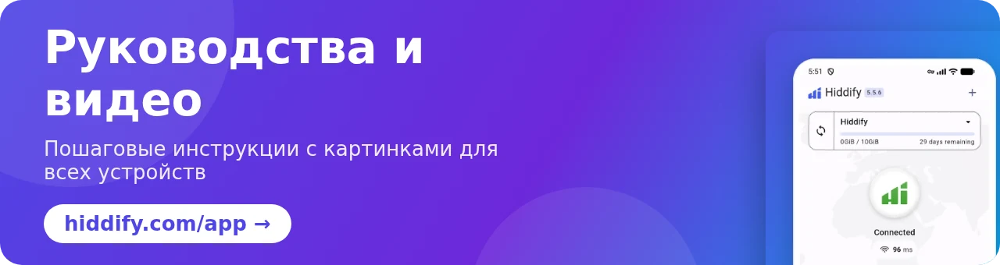

[**English 🇬🇧**](README.md) / [**فارسی 🇮🇷**](README_fa.md) / [**简体中文 🇨🇳**](README_cn.md) / [**日本語 🇯🇵**](README_ja.md) / [**Português-BR 🇧🇷**](README_br.md)

 

 

    
  

## Что такое приложение Hiddify?

Приложение Hiddify — бесплатный прокси- и VPN-клиент для **Android, iOS, Windows, macOS и Linux** с открытым исходным кодом и без рекламы. Оно основано на [sing-box](https://github.com/SagerNet/sing-box) и поддерживает почти все протоколы и форматы подписок, поэтому работает с любой панелью управления прокси, включая [Hiddify Manager](https://github.com/hiddify/Hiddify-Manager).

## 🚀 Основные возможности

- ✈️ **Одно приложение для всех устройств:** Android (телефоны и Android TV), iOS, Windows, macOS и Linux.
- 🎁 **Бесплатные профили:** подключайтесь без собственного сервера через встроенные бесплатные профили WARP и Psiphon.
- 🟡 **Множество протоколов:** VLESS, VMess, Trojan, Reality, Shadowsocks, Hysteria2, TUIC, WireGuard, SSH, AnyTLS и другие, а также новейшие возможности [Xray-core](https://github.com/XTLS/Xray-core) и sing-box, например [шифрование VLESS](https://github.com/hiddify/hiddify-sing-box/blob/v5/docs/hiddify/features/protocols/vless-encryption.en.md).
- 🔗 **Все форматы подписок:** sing-box, V2Ray (Base64 или обычные ссылки), Clash и Clash Meta, с автоматическим обновлением подписок.
- 🔍 **Автоматический выбор сервера:** приложение проверяет все серверы и выбирает самый быстрый; сервер можно выбрать и вручную.
- 🛡 **Дополнительная безопасность и обход блокировок прокси** для стран с жёсткой фильтрацией, с готовыми правилами для Ирана, Китая, России и других регионов.
- 🔀 **Режим VPN или прокси,** раздельная маршрутизация по приложениям на Android и раздача подключения другим устройствам в вашей сети.
- 📊 **Сведения о профиле:** сколько дней и трафика осталось по каждой подписке.
- 🌍 **30 языков,** тёмная и светлая темы.
- 💻 **[HiddifyCli](https://hiddify.com/app/HiddifyCli-guide/)** для серверов и компьютеров без графического интерфейса.
- ⭐ **Открытый исходный код, безопасность и развитие силами сообщества;** приложение доступно в официальных магазинах.

## 🛍️ Установка из магазинов приложений

&nbsp;&nbsp;&nbsp;&nbsp;&nbsp;&nbsp;&nbsp;&nbsp;

## 📥 Прямая загрузка

Файлы из [последнего релиза](https://github.com/hiddify/hiddify-app/releases/latest):

<table>
    <thead align=left>
        <tr>
            <th>ОС</th>
            <th>Загрузка</th>
        </tr>
    </thead>
    <tbody align=left>
        <tr>
            <td>Android</td>
            <td>
                 
                 
                 
                
            </td>
        </tr>
        <tr>
            <td>iOS</td>
            <td>
                 
                
            </td>
        </tr>
        <tr>
            <td>Windows</td>
            <td>
                 
                 
                
            </td>
        </tr>
        <tr>
            <td>macOS</td>
            <td>
                 
                 
                
            </td>
        </tr>
        <tr>
            <td>Linux</td>
            <td>
                 
                
            </td>
        </tr>
    </tbody>
</table>

## ⚙️ Установка и руководства

Пошаговые руководства с картинками для всех устройств есть на нашем сайте:

- [Как установить приложение Hiddify](https://hiddify.com/app/How-to-install-Hiddify-app/) (Android, iPhone, Windows, macOS, Linux)
- [Как пользоваться приложением Hiddify](https://hiddify.com/app/How-to-use-Hiddify-app/) (добавление профиля, подключение, выбор сервера, настройки)
- [Все руководства и видео по приложению](https://hiddify.com/app/)

## 🌎 Переводы

Приложение доступно на 30 языках. Улучшить перевод или добавить новый язык можно, отредактировав JSON-файлы в [`assets/translations`](assets/translations), или в [онлайн-редакторе Inlang](https://fink.inlang.com/github.com/hiddify/hiddify-app) .

## ✏️ Благодарности

Мы искренне благодарим участников этих проектов: без их прочной основы и возможностей этого приложения бы не было:

- [sing-box](https://github.com/SagerNet/sing-box)
- [Xray](https://github.com/XTLS/Xray-core)
- [sing-box для Android](https://github.com/SagerNet/sing-box-for-android)
- [sing-box для Apple](https://github.com/SagerNet/sing-box-for-apple)
- [Clash](https://github.com/Dreamacro/clash)
- [Clash Meta](https://github.com/MetaCubeX/Clash.Meta)
- [FClash](https://github.com/Fclash/Fclash)
- [Шрифт Vazirmatn от Saber Rastikerdar](https://github.com/rastikerdar/vazirmatn)
- [Другие](./pubspec.yaml)

## 🎯 Пожертвования и поддержка

Самый простой способ поддержать нас — поставить этому репозиторию звезду (⭐) вверху страницы.

<a href="https://next.ossinsight.io/widgets/official/analyze-repo-stars-history?repo_id=643504282" target="_blank" style="display: block" align="center">
  <picture>
    <source media="(prefers-color-scheme: dark)" srcset="https://next.ossinsight.io/widgets/official/analyze-repo-stars-history/thumbnail.png?repo_id=643504282&image_size=auto&color_scheme=dark" width="721" height="auto">
    
  </picture>
</a>

Нам также нужна финансовая поддержка для наших сервисов. Вся наша работа ведётся на добровольных началах, и каждое пожертвование идёт на развитие проекта. Подробнее — на нашей [странице пожертвований](https://hiddify.com/donation-and-support/).

## 👩‍🏫 Сотрудничество и контакты

Hiddify — проект, который развивает сообщество. Если вы хотите принять участие, прочитайте [руководство для участников](./CONTRIBUTING.md). Особенно нам нужна помощь с **Flutter, Go, разработкой под iOS (Swift) и Android (Kotlin)**.

 

Мы благодарим всех, кто участвует в этом проекте, — здесь, на GitHub, и многих других за его пределами. Это очень много для нас значит. ♥

Сделано с помощью <a target="_blank" href="https://contrib.rocks">Contrib.Rocks</a>

