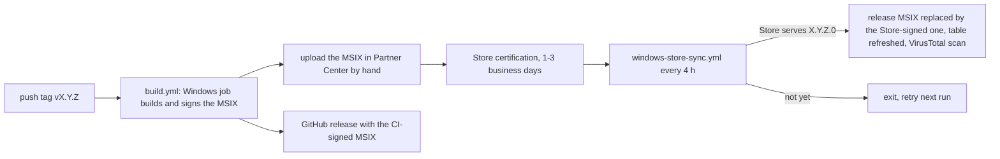

# Microsoft Store release pipeline

Hiddify ships to the Microsoft Store as an **MSIX** product with the package
identity `Hiddify.App.Win`. CI signs the MSIX for the submission. The Store then
re-signs it with Microsoft's certificate after certification. That signature
removes the SmartScreen problem that blocked the earlier EXE product. It also gives
users a signed MSIX that installs outside the Store.



## What happens on a release

1. **Build.** The Windows job packs and signs the MSIX with the CI certificate. The
   identity in `windows/packaging/msix/make_config.yaml` is never changed by CI. The
   build stops when the certificate Subject differs from that `publisher`.
2. **CI-signed MSIX in the release.** The draft and the release carry the MSIX as
   CI built it. Windows only installs it on machines that trust the CI certificate,
   until step 5 swaps it.
3. **Upload by hand.** Take `Hiddify-Windows-Setup-x64.Msix` from the `windows`
   artifact of the Release run and submit it in Partner Center (see
   [Each release](#each-release)). There is no automatic submission: the Store
   submission API requires a Microsoft Entra application.
4. **Wait.** `windows-store-sync.yml` runs every 4 hours. It takes the newest prod
   release whose MSIX is not labelled Store-signed yet and reads `msix_version` at
   that tag. It then asks the
   Store's delivery service whether that exact version is served yet.
5. **Attach.** Once it is served, the job downloads the Store-signed package. It
   checks the Store's SHA1 digest and the Authenticode signature, then replaces the
   release asset `Hiddify-Windows-Setup-x64.Msix` with it, labelled
   `Hiddify-Windows-Setup-x64.Msix (Store-signed)`. The label marks the release done. Finally it rewrites only the download
   table of the release notes and runs VirusTotal on the MSIX alone.

A rejected certification is reported by Partner Center by email; the sync job keeps
waiting until a newer prod release replaces the target.

## One-time setup

### 1. Partner Center product

Keep the package identity equal to Partner Center > **Product management >
Product identity**, or the Store rejects the upload:

| Partner Center | windows/packaging/msix/make_config.yaml |
| --- | --- |
| Package/Identity/Name: `Hiddify.App.Win` | `identity_name` |
| Package/Identity/Publisher | `publisher` (also the Subject of the signing certificate) |
| Reserved app name: `Hiddify ProxyVPN` | `display_name` (Package/Properties/DisplayName) |

The auto-start code in `lib/features/auto_start/notifier/auto_start_notifier.dart`
uses the same name. Copy the product's **Store ID** (12 characters, starts with
`9`) into the `MSSTORE_PRODUCT_ID` variable.

The older product `9PDFNL3QV2S5` uses the identity `Hiddify.HiddifyNext` and stays
on 4.1.1.0. Its users do not move to the new product automatically.

### 2. GitHub variable

Repository **Settings > Secrets and variables > Actions > Variables**:

```bash
gh variable set MSSTORE_PRODUCT_ID --repo hiddify/hiddify-app --body 9NXXXXXXXXXX
```

Without it the sync workflow skips itself. No secrets are needed.

## Each release

1. Push the prod tag as usual. The release is published with the CI-signed MSIX.
2. Download the `windows` artifact from that Release run and extract
   `Hiddify-Windows-Setup-x64.Msix`. It is signed with the CI certificate.
3. Partner Center > the `Hiddify.App.Win` app > **Start update** > **Packages**:
   remove the old package, upload the new one, then **Submit for certification**.
4. Nothing else. Once the Store serves the new version, *Windows Store Sync*
   swaps in the Store-signed MSIX and updates the release notes.

## Versions

The Store needs a strictly higher version on every submission, with `0` as the
fourth part. `.github/change_version.sh` sets `msix_version` to `X.Y.Z.0`, which
fits as long as every prod release has a new `X.Y.Z`.

## Manual operations

- **Attach a specific release:** run *Windows Store Sync* from the Actions tab with
  the tag.
- **List what the Store serves:** on Windows,
  `./windows/scripts/fetch_store_msix.ps1 -ProductId 9N... -List`.
- **Resubmit after a rejection:** fix the issue, push a new patch tag.

## How the Store-signed package is downloaded

Microsoft has no official CI download for Store-signed packages. `winget download`
needs an interactive Entra sign-in with an admin role. `fetch_store_msix.ps1`
therefore uses the anonymous endpoints the Store client uses. The display catalog
maps the Store ID to the update category. The delivery service (FE3) then lists the
package versions and returns a CDN URL. This is the method behind StoreLib and
store.rg-adguard.net, and it replaces the old `add_signed_microsft.yml` workflow,
which attached whatever version the Store served and never ran for prerelease
releases. It is unofficial and Microsoft could change it. When it
breaks, the sync job fails visibly, and the MSIX can be attached by hand meanwhile.

## The old EXE product ("HiddifyExe")

Its 2024 certification failed two policies:

- **10.2.10 SmartScreen.** EXE and MSI products must be signed with a certificate
  from a CA in the Microsoft Trusted Root Program; the Store does not re-sign them.
  CI still signs with a self-issued certificate, so this would fail again until
  Azure Artifact Signing or a CA certificate is configured
  (see [windows-code-signing.md](windows-code-signing.md)).
- **10.2.7 Add or Remove Programs.** Fixed. The installer now writes the name
  `Hiddify`, the publisher `Hiddify` and the app icon.

The MSIX product avoids the trusted-CA requirement: the Store re-signs MSIX packages.
