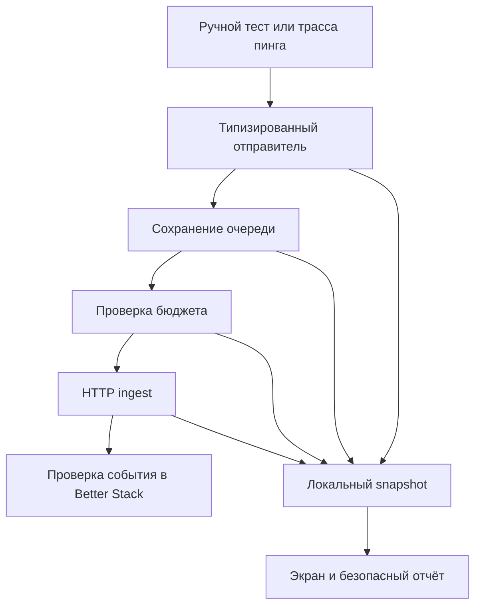
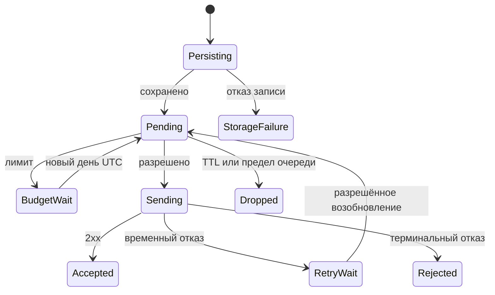

# Blizzard telemetry delivery and visual tuning - Plan

## Goal Capsule

**Цель:** в следующем релизе оператор может проверить получение диагностики или увидеть конкретную причину задержки, а пользователь получает согласованный интерфейс Blizzard v3.

**Подход:** локально наблюдаемый отправитель, исправление подтверждённых сбоев доставки, перенос последнего дизайна и отдельная проверка их совместной работы.

**Полномочия:** этот документ описывает реализацию и выпуск; текущий запрос разрешает подготовку плана. Сборку и публикацию не считать выполненными. Работа начинается в изолированной ветке от подтверждённой актуальной линии build 21; исходные checkout сохраняются.

**Остановка:** обнаруженное изменение VPN-маршрутов, идентичности приложения или необходимость новой серверной функции требует отдельного решения. Недоступная проверка на iPhone фиксируется как BLOCKED, без объявления физической приёмки успешной.

---

## Product Contract

### Summary

Выпустить исправление диагностики вместе с визуальным обновлением из чата «Составь план визуального тюнинга». Сохранить бесплатный режим для группы до 10 тестировщиков. Проверять получение событий на стороне Better Stack отдельно от их постановки в очередь и HTTP-подтверждения.

### Problem Frame

На установленной версии 0.0.1 (21) два ручных теста, с VPN и без него, показали «Событие поставлено в очередь». В предыдущей проверке Better Stack не было событий build 21; последняя полученная запись относилась к build 20, 22.10.2026 10:05:42 UTC. Улучшение блокировки/разблокировки наблюдал пользователь, но удалённая диагностика его пока не подтверждает.

Текущий интерфейс не показывает, что произошло после постановки события в очередь. Пустой удалённый результат совместим с отказом локального хранилища, исчерпанием бюджета, паузой повторов и ошибкой запроса. Причина на устройстве не установлена.

### Requirements

**Доставка и её проверка**

- R1. На экране безопасной диагностики доступны состояние отправителя, количество и возраст ожидающих событий, расход и остаток суточного бюджета, время следующей допустимой попытки и результат последнего запроса.
- R2. Ручной тест различает сохранение локально, ожидание отправки, принятие сервером и отказ; «принято сервером» появляется только для подтверждённого 2xx именно его пакета.
- R3. Локальный безопасный отчёт содержит состояние отправителя даже при полностью недоступной удалённой доставке; отказ сохранения и отказ бюджета различимы.
- R4. События восстанавливаются после перезапуска и временной недоступности сети в существующих пределах очереди; исчерпание бюджета и ограничение повторов остаются явными причинами ожидания.
- R5. Достаточность исправления подтверждается появлением ручного события и трассы нового сценария блокировки/разблокировки в Better Stack для точной новой сборки.

**Бесплатная квота и приватность**

- R6. Сохранить лимит логов 64 KiB на установку в сутки UTC, включая неудачные запросы и повторы; Sentry — не более 1 события в день и 10 в месяц на установку. Ручной тест не обходит лимиты, а обновление приложения не обнуляет израсходованный бюджет.
- R7. В новых данных разрешены только перечисленные числовые поля, время и закрытые коды причин. Запрещены токены, адреса серверов и подписок, заголовки, тела HTTP-ответов, сырые исключения, профили и посещённые ресурсы. Отказ от диагностики сохраняет действующее отключение и очистку очереди.

**Интерфейс**

- R8. Перенести последнее состояние Blizzard v3 для существующих экранов и действий: главная, серверы, настройки, формы импорта/профиля, журналы, диалоги, загрузки и ошибки.
- R9. На главной применить выровненные положения кнопки, подписи действия и первой карточки во всех состояниях, включая двухстрочный заголовок. Кнопка имеет целевой размер 148×148 pt; увеличенная волна обволакивает её со всех сторон и затухает возле текста.
- R10. Для кнопки и нижней панели использовать настоящий Apple UIGlassEffect на iOS 26+, с проверенным fallback для более ранней поддерживаемой iOS и непрозрачным вариантом Reduce Transparency. Flutter сохраняет действие и семантику; карточки остаются непрозрачными.
- R11. Нижняя навигация сохраняет существующие вкладки «Главная» / «Настройки», получает компактную плавающую форму, иконку дома и ясное выделение выбранной вкладки.
- R12. Сохранить название Blizzard VPN и «Blizzard + установленная версия (build)» в шапке. Сохранить последний проверенный пинг при сворачивании и «Обновление…» после возврата до свежего результата.
- R13. Доступность и геометрия проверяются на компактном и большом экране, с крупным текстом, VoiceOver, Reduce Motion, Reduce Transparency и Increase Contrast. Декоративная анимация останавливается в фоне и не создаёт ложных признаков работающего VPN.

### Scope Boundaries

Тюнинг переносится на существующие функции, без изменения выбора сервера, balancer/consistent hash, VPN core, PacketTunnel, сетевых маршрутов и срока замера пинга. Проблемы трафика не маскируются изменением подписи пинга.

12 состояний кабинета из дизайн-пакета сохраняются как дизайн-источник. В просмотренной релизной линии нет отдельной функции кабинета/входа. Добавление авторизации, backend и третьей вкладки не входит в визуальный перенос этого релиза.

Не добавлять новый сервис мониторинга, платный тариф, постоянную фоновую отправку, сырые VPN-логи или удалённое управление устройством. Не расширять оформление на несвязанные платформы и темы за пределами существующей eligibility Blizzard.

### Acceptance Examples

- AE1. Covers R1–R3: хранилище возвращает ошибку записи — тест показывает проблему сохранения, отчёт доступен локально, сетевой запрос не заявляется выполненным.
- AE2. Covers R4, R6: после обновления из build 20 сохранён расход 90 KiB текущего дня — отправка ожидает следующего дня UTC, бюджет не обнуляется. При доступном бюджете следующего дня сохранённые неистёкшие события отправляются.
- AE3. Covers R2, R5: сервер возвращает 2xx для пакета с тестом — приложение показывает принятие сервером; оператор отдельно находит этот тест в Better Stack.
- AE4. Covers R9, R12: состояния «Подключено», «Отключено» и «Требуется переподключение» сохраняют общую геометрию при обычном размере текста; крупный текст получает достаточное место без обрезки.
- AE5. Covers R10, R13: пользователь включает Reduce Transparency или Reduce Motion — материал/движение адаптируются, кнопка нажимается один раз и остаётся единственным доступным действием для VoiceOver.

---

## Planning Contract

### Evidence and Sources

- Релизный исходник build 21: `3092d6e0644996b2d219f63774aca897eade9ebd`, ветка `fix/ios-remote-resume-diagnostics`; checkout был чистым до добавления этого плана. Исторический объём работ: `docs/plans/2026-10-22-remote-diagnostics.md`.
- `lib/core/analytics/analytics_controller.dart:115`: `sendTestEvent()` возвращает bool постановки и запускает `flush()` без ожидания результата. `lib/features/diagnostics/safe_diagnostics_page.dart` показывает только ответ о постановке.
- `lib/core/observability/better_stack_log_printer.dart`: после сохранения очереди резервирует бюджет, выполняет запрос, подтверждает пакет либо сохраняет паузу; ошибки транспорта поглощаются. `_budgetBlockedDay` сейчас также скрывает ошибки, для которых `reserveLogs()` вернул false.
- `lib/core/observability/telemetry_budget.dart`: один preference key между версиями; текущий лимит ниже прежних 256 KiB. Это проверяемая гипотеза суточной блокировки после обновления, а не установленная причина на iPhone.
- `lib/features/diagnostics/remote_ios_ping_subscription.dart`: `resumePending()` уже вызывается при возобновлении. Не добавлять второй параллельный путь восстановления без воспроизведённого дефекта.
- Точный дизайн-чат: `01a16010-8b6a-7c13-8ac4-91bd8dadafcf`, «Составь план визуального тюнинга». Последними изменениями были выравнивание главной и увеличенная обволакивающая волна; они имеют приоритет перед ранними изображениями v2.
- Внешние локальные входы относительно checkout: `../design-exports/blizzard-v3-all-screens-2026-10-22/coverage.md` связывает 89 исходных состояний, 12 состояний кабинета и 4 дополнительных варианта; `../design-assets/blizzard-v3/blizzard-wave-envelope.glsl` задаёт последнюю волну. Макеты находятся в pen.dev; перед реализацией читать выбранные узлы через Pencil MCP.
- Нативный донор: `../blizzard-native-liquid-glass`, HEAD `30f89298f37e25dee35595dbe0536b3bddee5421` плюс незакоммиченные изменения. Его `docs/verification/blizzard/native-liquid-glass.md` подтверждает отдельный компонент в симуляторе, но прямо оставляет полное приложение и iPhone непроверенными.

### Key Technical Decisions

- KTD1. **Сначала наблюдаемость отправителя, затем минимальное исправление доказанной причины.** Добавить типизированный локальный snapshot и исходы операций. Не логировать ошибки самого отправителя через него же, чтобы не создавать рекурсию и расход квоты.
- KTD2. **Разделить отказ бюджета и ошибки хранилища.** Вместо одного bool результата резервирования вернуть закрытый исход: разрешено, лимит, некорректное сохранённое состояние, ошибка записи. Существующие счётчики и защиту от отката часов сохранить по R6.
- KTD3. **Не считать удаление события подтверждением доставки.** Удалённый из-за терминального отказа/истечения/переполнения тест получает соответствующий исход. Один тест отслеживается по существующему идентификатору события, без передачи исходного payload в UI. Если тест ещё ждёт пакет, экран продолжает показывать ожидание; не увеличивать штатные лимиты ради проверки.
- KTD4. **Перенести UI адресно поверх линии build 21.** Не заменять checkout целиком веткой донора. Зафиксировать manifest выбранных файлов, хеши, дизайн-ID и отличие от текущего релиза; незакоммиченные файлы донора также входят в снимок. Разделить коммиты диагностики и визуального переноса.
- KTD5. **Сохранить материал UIKit под существующими Flutter-контролами.** Перенести регистрацию, Swift-файл, проект и тесты донора, затем повторить доказательство преломления над Flutter-фоном в полном приложении. Исходный GLSL pen.dev — спецификация эффекта; не считать его готовым Flutter shader без адаптации.
- KTD6. **Номер следующей сборки определить перед выпуском.** Build 21 повторно не загружать. Выпуск вести через существующий доверенный controller, новый точный source SHA и существующую группу Test; не переносить старые source pins из дизайн-ветки.

### High-Level Technical Design

Работы идут U1 → U2 → U3 и U1 → U4 → U5; интеграция и релизная проверка U6 ждёт обе цепочки. Автоматическое возобновление в переходах использует существующий жизненный цикл, а не обещание работы приложения в заблокированном состоянии.

### Risks and Budget

64 KiB × 10 × 31 = 20 316 160 байт, около 20,3 MB в месяц на учтённые установками запросы. Sentry — до 100 событий в месяц. Это существенно ниже ранее проверенных публичных бесплатных лимитов Better Stack 3 GB и Sentry 5000 errors; условия и общий расход аккаунта проверить перед выпуском. Другие источники, старые версии и переустановка не покрываются этой локальной гарантией. Источники: [Better Stack pricing](https://betterstack.com/pricing), [HTTP ingest](https://betterstack.com/docs/logs/ingesting-data/http/logs/), [Sentry pricing](https://sentry.io/pricing/).

Неизвестная причина отсутствия логов остаётся задачей U2–U3. Полный перенос v3 требует runtime-проверки; статическая карта 105 макетов не означает 105 уже реализованных Flutter-экранов. Незакоммиченный донор и разные Git object databases исключают слепой cherry-pick по одному HEAD.

---

## Implementation Units

### U1. Freeze inputs and transfer map

**Цель:** получить воспроизводимую основу объединённого релиза. **Requirements:** R8–R12. **Dependencies:** нет.

**Files:** новые `docs/verification/blizzard/combined-release-inputs.json` и `docs/verification/blizzard/v3-transfer-map.md`; действующая карта `docs/verification/blizzard/screen-action-contract.json`.

**Approach:** записать текущую релизную линию, полный снимок выбранных изменений донора и хеши ассетов по KTD4. Через Pencil MCP сверить v3, финальные состояния главной и волну. Для каждого существующего семейства указать дизайн-ID, Flutter-компонент, действие и проверку. Исторические/иллюстративные значения макетов не переносить как данные пользователя. Сохранить более поздние правки геометрии и волны. Устаревшее предложение убрать версию из шапки отклонить по R12.

**Test expectation:** новых поведенческих тестов нет, это фиксация входов. **Verification:** все применимые семейства из 89 состояний сопоставлены; отсутствующие функции отделены по Scope Boundaries; чужие изменения сохранены.

### U2. Expose safe delivery outcomes

**Цель:** определить точное место остановки отправки независимо от облака. **Requirements:** R1–R3, R7. **Dependencies:** U1.

**Files:** `lib/core/observability/better_stack_log_printer.dart`, `telemetry_budget.dart` в той же директории; новый `lib/core/observability/telemetry_delivery_status.dart`; `lib/core/analytics/analytics_controller.dart`; `lib/features/diagnostics/safe_diagnostics_page.dart`, `safe_diagnostic_journal.dart`; соответствующие существующие тесты в `test/core/observability/` и `test/features/diagnostics/`.

**Approach:** реализовать KTD1–KTD3. Snapshot показывает только R1/R7, без захвата ответа/исключения. Обновить закрытую схему экспорта вместе с валидатором и обратной совместимостью старых отчётов. Сообщения экрана локализовать; состояние обновляется при смене исхода, без постоянного опроса. Локальный успех HTTP и удалённая видимость имеют разные формулировки.

**Execution note:** необходимые тесты поведения написать до изменения production-кода.

**Test scenarios:**

- Запись очереди вернула false/исключение — нет HTTP и нет сообщения о надёжном сохранении.
- Бюджет исчерпан, испорчен или не записался — три различимых безопасных исхода.
- 2xx относится другому пакету — ожидающий тест не объявляется принятым.
- 401/402/403 и другой 4xx — конкретный закрытый отказ, без ложного подтверждения.
- Очередь выкинула тест по TTL/переполнению — ожидание заканчивается объяснением.
- Копирование безопасного отчёта при отсутствии сети содержит snapshot и не содержит запрещённых R7 данных.

**Verification:** экран и отчёт объясняют каждый путь выхода отправителя; старые безопасные отчёты по-прежнему читаются.

### U3. Reproduce and repair delivery stop

**Цель:** устранить подтверждённый дефект доставки без обхода квоты. **Requirements:** R4–R7. **Dependencies:** U2.

**Files:** `lib/core/observability/better_stack_log_printer.dart`, `telemetry_budget.dart`; `lib/features/diagnostics/remote_ios_ping_subscription.dart` только при обнаруженном дефекте интеграции; `test/core/observability/better_stack_log_printer_test.dart`, `telemetry_budget_test.dart`, `test/features/diagnostics/remote_ios_ping_subscription_test.dart`; `docs/betterstack.md` для согласования описанных лимитов и проверки доставки с R2/R6.

**Approach:** воспроизвести каждый кандидат управляемым временем, хранилищем и транспортом. Зафиксировать, какой путь объясняет наблюдение, а какие лишь возможны. Корректное ожидание квоты не «исправлять» обнулением. Если очередь блокирует весь пакет при остатке, достаточном для части событий, формировать подходящий по бюджету префикс; иначе явно ждать. Исправлять восстановление только если соответствующий тест выявил отказ. Точный дефект на пользовательском устройстве может стать известен лишь после установки новой сборки с U2; это ограничение не скрывать.

**Execution note:** для каждого исправления сначала воспроизведение RED, затем минимальная правка и GREEN.

**Test scenarios:**

- Расход 90 KiB из build 20 в тот же день и переход дня UTC: AE2.
- Остаток меньше пакета, но достаточен для первого события — отправляется допустимая часть; слишком малый остаток сохраняет очередь.
- Нет сети → перезапуск → восстановление сети → возобновление: тот же event ID и исходные build/time, без потери событий.
- Три временных отказа → пауза → существующий resumePending: нет бесконечного цикла, нет превышения бюджета.
- Событие добавляется во время запроса — подтверждение удаляет только отправленный пакет.
- Отключение диагностики во время отправки очищает очередь и не восстанавливает старые данные при включении.

**Verification:** регрессии доказывают исправляемые пути; фактическая причина на iPhone не объявляется известной по одним mock-тестам.

### U4. Transfer native Apple material

**Цель:** включить проверенную нативную основу стекла в совместный исходник. **Requirements:** R10, R13. **Dependencies:** U1.

**Files:** `lib/core/widget/blizzard/blizzard_glass.dart`; новый `ios/Runner/BlizzardNativeGlass.swift`; `ios/Runner/AppDelegate.swift`, `ios/Runner.xcodeproj/project.pbxproj`, `ios/RunnerTests/RunnerTests.swift`; новый `test/visual/blizzard_native_glass_test.dart`; `test/ci/blizzard_runtime_boundary_test.rb`.

**Approach:** перенести только материал и регистрацию по KTD5, с доказательством сохранности остальных native/runtime файлов. Старый guard из донорской ветки нельзя ослаблять широким разрешением: сверить с новой базой диагностики и разрешить только точный glass-diff. Не менять deployment target ради стекла. Убедиться, что trusted build runner поддерживает нужный SDK до подписанной сборки.

**Test scenarios:**

- iOS 26+: реальный UIGlassEffect и нужные .clear/.regular, видимый отклик на меняющийся Flutter-фон.
- Более ранняя поддерживаемая iOS: системный fallback без обращения к недоступному API.
- Изменение радиуса/материала обновляет platform view; rebuild не дублирует действие.
- Reduce Transparency и VoiceOver: непрозрачный fallback, один Flutter-action, нативный слой не перехватывает ввод/фокус.

**Verification:** новые widget/native тесты, полный host build и сравнение whole-window снимков; старые результаты из отдельного probe не подменяют проверку интеграции.

### U5. Apply Blizzard v3 screens and enveloping wave

**Цель:** перенести согласованное оформление на работающий интерфейс. **Requirements:** R8, R9, R11–R13. **Dependencies:** U1, U4.

**Files:** `lib/core/theme/blizzard_tokens.dart`, `blizzard_theme.dart`; `lib/core/widget/blizzard/blizzard_scene.dart`; `lib/core/router/adaptive_layout/my_adaptive_layout.dart`; `lib/features/home/widget/home_page.dart`, `connection_button.dart`; `lib/features/proxy/widget/proxy_tile.dart`, `lib/features/settings/overview/`, `lib/features/profile/` и общие dialog widgets по карте U1; `test/visual/`, `test/ui_preservation/`. Новые ассеты — только по зафиксированному manifest U1.

**Approach:** применять токены/общие компоненты по семействам U1, сохраняя callbacks, provider bindings, storage и маршруты. Последнюю волну адаптировать к существующему renderer; тихие зоны текста и финальная геометрия обязательны, весь pen.dev GLSL слепо не копировать. Для Reduce Motion использовать статичный вариант; фоновый ticker останавливать. Существующие переходы и данные определяют содержимое карточек, а не значения из макета. Экран безопасной диагностики U2 оформить теми же компонентами без потери новых состояний доставки.

**Test scenarios:**

- Все состояния главной имеют согласованное выравнивание; двухстрочный статус/длинный профиль не перекрывают кнопку.
- Крупный текст и 320×568: доступны подписи, основной action и прокрутка; 430×932: сохраняется композиция.
- Переключение сервера/вкладки/темы сохраняет выбранное значение, draft, focus и число вызовов действия.
- Сворачивание/возврат сохраняет поведение пинга R12, а декор не продолжает активную анимацию в фоне.
- Reduce Motion/Transparency, Increase Contrast и VoiceOver соответствуют R13; legacy eligibility не изменена.

**Verification:** актуальные снимки представительных состояний каждого семейства карты U1 плюс отдельный список непроверенных состояний; требуется визуальная сверка с последним v3.

### U6. Combined acceptance and next TestFlight build

**Цель:** проверить один итоговый бинарник и его доставку. **Requirements:** R5, R6, R12, R13. **Dependencies:** U2–U5.

**Files:** новый `docs/verification/blizzard/combined-release-acceptance.md`; существующие manifest/receipts release controller; его `.github/workflows/ios-baseline.yml` и pin tests менять только при штатной подготовке точного нового source SHA.

**Approach:** сначала интеграционные проверки и unsigned/validation gates. Затем по авторизации выпуска определить свободный build number, подготовить exact source/controller pins, подписать и загрузить один новый artifact. После загрузки сбой подтверждения группы решать status/resume, без повторной загрузки IPA. Оставить возможность визуального отката отдельным новым build с `BLIZZARD_VISUALS=false`; исправление диагностики при этом сохраняется. Не обещать исправление установленного бинарника изменением compile-time flag.

**Test scenarios:**

- Обновление поверх build 21 сохраняет профиль, выбранный сервер и счётчики бюджета.
- Ручной тест с VPN и без него показывает исход U2; соответствующее событие найдено для нового build в Better Stack.
- Блокировка 60 секунд и разблокировка, несколько повторов: сайты/DNS работают, выбранный сервер не сбрасывается, свежий пинг появляется; удалённая трасса содержит этот сценарий.
- Главная, серверы, настройки, импорт и безопасная диагностика проходят физическую визуальную/доступную приёмку на том же бинарнике.

**Verification:** отдельные записи о тестах исходника, полном приложении, физическом iPhone, удалённом ingress и Apple receipt. При невозможности физической проверки выпуск в TestFlight может быть доставлен, но релизная приёмка остаётся незавершённой.

---

## Verification Contract

Все команды ниже относятся к реализации, а не к текущему планированию. Использовать закреплённый проектом Flutter SDK и точные входы сборки.

| Проверка | Выполнение | Условие прохождения |
|---|---|---|
| Доставка/бюджет | `flutter test test/core/observability test/features/diagnostics` | Все новые сценарии и прежние регрессии проходят |
| UI и bindings | `flutter test test/visual test/ui_preservation` | Нет изменений действий и геометрических регрессий |
| Native boundary | `ruby test/ci/blizzard_runtime_boundary_test.rb` | Только согласованные native glass изменения поверх новой базы |
| Полный host suite | `flutter test` и анализ изменённых production/test файлов | Нет новых ошибок; известные baseline diagnostics перечислены отдельно |
| Полный iOS binary | Штатный controller validation + XCTest/host material checks | Совместимый SDK, правильные entitlements и идентичность, стекло в полном приложении |
| Физический iPhone | Сценарии U6 на exact artifact | Отдельно подтверждены трафик, пинг, UI и доступность |
| Better Stack | Безопасный запрос по новому build и периоду теста | Найдены тест и новая resume-трасса; 2xx отдельно от видимости в поиске |
| TestFlight | Live Apple inventory/receipt | `processingState=VALID`, beta-ready state и `assigned=true` группе Test; signing readiness возвращён false |

---

## Definition of Done

- U1–U6 имеют указанные результаты, применимые проверки пройдены, непроверенные физические условия честно отмечены и не выданы за PASS.
- Сообщение «в очереди» больше не оставляет оператора без сведений о причине задержки; отказ хранилища, квота, повторы и HTTP различимы.
- Доставка ручного события и resume-трассы доказана для нового build. Если этого нет, диагностика не считается принятой, даже при зелёных unit-тестах.
- UI соответствует последнему v3 для существующих функций, включая нативный материал, финальную волну и выравнивание; версия в шапке показывает реальный build.
- Нет изменений VPN/core/routes/identity и сброса бюджета; приватность R7 проверена на экспортируемых данных.
- Сохранены точные source/controller SHA, ассеты и receipts. Временный probe-код и отвергнутые реализации не входят в diff; исходные checkout не повреждены.
- Готовность TestFlight и фактическая приёмка на устройстве описаны отдельно. Планирование само по себе ни одну из них не подтверждает.
